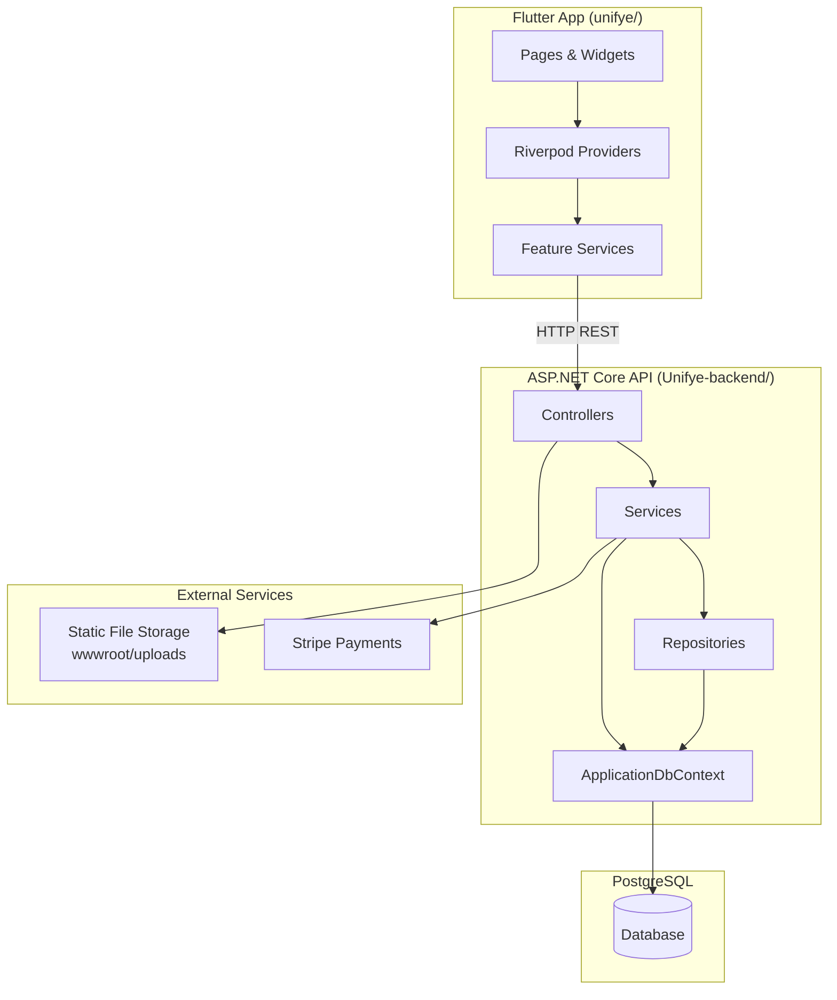

# UniFye — System Architecture & Technology Overview

UniFye is a university-focused social and communication platform. Students can discover peers through swiping, manage profiles, subscribe to premium tiers, send direct messages, and participate in campus events. The system is split into a **Flutter mobile/desktop client** and an **ASP.NET Core REST API** backed by **PostgreSQL**.

---

## Table of Contents

1. [Design Patterns](#design-patterns)
2. [High-Level Architecture](#high-level-architecture)
3. [Backend](#backend)
4. [Frontend](#frontend)
5. [Domain Features](#domain-features)
6. [API Overview](#api-overview)
7. [Technology Stack Summary](#technology-stack-summary)
8. [Project Structure](#project-structure)
9. [Current State & Known Gaps](#current-state--known-gaps)

---

## Design Patterns

UniFye uses a **layered architecture** on the backend and a **feature-oriented client architecture** on the frontend. The patterns below appear consistently across the codebase, though adoption is **partial** in some areas (notably repositories).

### Backend Patterns

| Pattern | Description | Where Used |
|---------|-------------|------------|
| **Layered (N-Tier) Architecture** | HTTP → Controller → Service → Data Access → Database. Each layer has a single responsibility. | Entire backend (`Controllers/`, `Services/`, `Repositories/`, `Data/`) |
| **Service Layer** | Business logic, validation, authorization rules, and DTO mapping live in services. Controllers stay thin. | `AuthService`, `SwipeService`, `ProfileService`, `SubscriptionService`, `EventService`, `MessageService` |
| **Repository Pattern (partial)** | Data access is abstracted behind interfaces for some domains. Other services query `ApplicationDbContext` directly. | Events, Subscriptions, Messages use repositories; Auth, Swipe, Profile use DbContext directly |
| **Dependency Injection (DI)** | Constructor injection via ASP.NET Core's built-in container. All services registered as **Scoped** (one instance per HTTP request). | `Program.cs` |
| **DTO (Data Transfer Object)** | API contracts are separate from EF Core entity models. Prevents over-posting and decouples the API from the database schema. | `DTOs/` folder (requests and responses) |
| **Result Object Pattern** | `AuthServiceResult<T>` wraps success/failure with HTTP status codes. Services return results; controllers map them to `Ok()`, `NotFound()`, etc. | `Services/AuthServiceResult.cs` |
| **Fluent API (EF Core)** | Entity relationships, indexes, constraints, and table naming configured in `OnModelCreating`. | `Data/ApplicationDbContext.cs` |
| **Database Seeding** | Initial subscription plans and feature permissions seeded on startup if tables are empty. | `Data/Seeders/SubscriptionPlanSeeder.cs` |

### Frontend Patterns

| Pattern | Description | Where Used |
|---------|-------------|------------|
| **Provider / State Management (Riverpod)** | Global and feature-scoped state via `StateNotifierProvider`, `AsyncNotifierProvider`, and `Provider`. UI watches providers and rebuilds reactively. | `features/*/providers/`, `actions/` |
| **Feature-First Modules** | Code grouped by domain (auth, profile, swipe, subscription) with co-located models, services, and providers. | `lib/features/` |
| **Repository Pattern** | Profile data access abstracted behind `ProfileRepository`. | `features/profile/respositories/` |
| **Service + Notifier** | HTTP services perform API calls; notifiers hold state and orchestrate loading/error/success. | Auth, swipe, subscription features |
| **Auth Gate Routing** | Root widget switches between login and main app based on authentication state. | `core/router/app_router.dart` |
| **Tab Shell with Nested Navigators** | Main layout uses a bottom navigation bar; each tab has its own `Navigator` to preserve stack state. | `pages/layout_page.dart` |
| **Immutable Models (Freezed)** | Union types and immutable data classes for auth state, login state, and user models. | `features/auth/models/` |
| **Optimistic UI Updates** | Profile edits apply locally first, then roll back on API failure. | Profile feature |

### Architectural Style Summary

```
┌─────────────────────────────────────────────────────────────┐
│                     Flutter Client (UniFye)                  │
│  Pages → Riverpod Providers → Services/Repositories → HTTP  │
└────────────────────────────┬────────────────────────────────┘
                             │ REST (JSON) / Multipart
                             ▼
┌─────────────────────────────────────────────────────────────┐
│                  ASP.NET Core Web API                        │
│  Controllers → Services → Repositories/DbContext → EF Core  │
└────────────────────────────┬────────────────────────────────┘
                             │ Npgsql
                             ▼
┌─────────────────────────────────────────────────────────────┐
│                      PostgreSQL                              │
│                   (schema: development)                      │
└─────────────────────────────────────────────────────────────┘
```

This is a **monolithic REST API** with a **single-page-style mobile client**. There is no message bus, API gateway, or microservice decomposition.

---

## High-Level Architecture



**Communication:** The Flutter app calls the API at `http://localhost:5219` (or `http://10.0.2.2:5219` on Android emulators). Protected endpoints use JWT Bearer tokens in the `Authorization` header.

---

## Backend

**Location:** `Unifye-backend/Unifye/Unifye/`  
**Framework:** ASP.NET Core Web API on **.NET 10**

### Layers

| Layer | Path | Responsibility |
|-------|------|----------------|
| **Controllers** | `Controllers/` | HTTP routing, request binding, auth attributes, response mapping |
| **Services** | `Services/` | Business logic, validation, authorization, DTO mapping |
| **Repositories** | `Repositories/` (+ root-level `SubscriptionRepository.cs`) | EF Core queries and persistence for selected domains |
| **Models** | `Models/` | EF Core entity classes (database schema) |
| **DTOs** | `DTOs/` | Request/response contracts for the API |
| **Data** | `Data/` | `ApplicationDbContext`, migrations, seeders |
| **Enums** | `Enums/` | Subscription tiers, statuses, permission gates |

### Dependency Injection

All services are registered in `Program.cs` with **scoped** lifetime:

```csharp
builder.Services.AddDbContext<ApplicationDbContext>(...);
builder.Services.AddScoped<IAuthService, AuthService>();
builder.Services.AddScoped<ISwipeService, SwipeService>();
builder.Services.AddScoped<ISubscriptionRepository, SubscriptionRepository>();
builder.Services.AddScoped<IStripeService, StripeService>();
builder.Services.AddScoped<ISubscriptionService, SubscriptionService>();
```

Additional services (Profile, Event, Message) exist in code but are not yet registered in DI — see [Known Gaps](#current-state--known-gaps).

### Database

- **Provider:** PostgreSQL via `Npgsql.EntityFrameworkCore.PostgreSQL`
- **ORM:** Entity Framework Core 10
- **Default schema:** `development`
- **Naming:** Snake_case table names (`users`, `user_profiles`, `events`, etc.)
- **Migrations:** Applied automatically on startup via `db.Database.Migrate()`
- **Notable features:** JSONB column for subscription history metadata, unique indexes for swipes/matches/subscriptions, email normalization via value converter

### Key Entities

| Entity | Purpose |
|--------|---------|
| `User` / `UserProfile` | Authentication credentials and profile data (1:1 split) |
| `UserSwipe` / `UserMatch` | Swipe actions and mutual matches |
| `Conversation` / `Message` | Direct messaging between matched users |
| `SubscriptionPlan` / `UserSubscription` | Tiered plans with Stripe integration |
| `PlanFeaturePermissions` | Feature gating per subscription tier |
| `Event` / `EventAttendee` / `EventChatMessage` | Campus events with attendance and group chat |

### Authentication

- **Password hashing:** BCrypt (`BCrypt.Net-Next`)
- **Token validation:** JWT Bearer middleware configured in `Program.cs`
- **Protected routes:** Profile, Events, Messages, and most subscription endpoints require `[Authorize]`
- **Public routes:** Auth login/register, swipe endpoints, subscription plans/webhook

### Static Assets

Profile images are uploaded to `wwwroot/uploads/profiles/` and served via `app.UseStaticFiles()`.

---

## Frontend

**Location:** `unifye/`  
**Framework:** Flutter (Dart SDK `>=3.0.0 <4.0.0`)

### Architecture

The client uses a hybrid structure:

- **`lib/features/`** — Domain modules (auth, profile, swipe, subscription) with models, services, and Riverpod providers
- **`lib/pages/`** — Screen-level UI (login, layout shell, swipe, events, messages, profile)
- **`lib/core/`** — Router and theme
- **`lib/widgets/`** — Shared UI components

### State Management

**Flutter Riverpod 2.x** is the sole state management solution. The app is wrapped in `ProviderScope` at startup. Key providers:

| Provider | Domain |
|----------|--------|
| `authProvider` | Authentication state (authenticated / unauthenticated / loading) |
| `loginProvider` | Login form actions |
| `registrationProvider` | Multi-step registration flow |
| `swipeProvider` | Discover/swipe candidates |
| `profileProvider` | User profile CRUD |
| `subscriptionProvider` | Plans, checkout, billing portal |
| `eventsProvider` | Event listing and management (inline in `event_page.dart`) |

### Navigation

- **No go_router** — navigation is imperative
- **Auth gate:** `AppRouter` watches `authProvider` and shows `LoginPage` or `LayoutPage`
- **Main shell:** `LayoutPage` provides 4 tabs (Discover, Events, Messages, Profile) with nested navigators per tab
- **Deep links:** `Navigator.push` with `MaterialPageRoute` for sub-screens (register, change plan, message threads)

### API Connection

Base URL is configured at startup in `main.dart`:

| Platform | URL |
|----------|-----|
| Android emulator | `http://10.0.2.2:5219` |
| iOS / Web / Desktop | `http://localhost:5219` |

HTTP calls use the `http` package directly — there is no shared API client, interceptor layer, or retry logic. Auth tokens are sent as `Authorization: Bearer <token>` on protected endpoints.

### Build Flavors

Android defines `development` and `production` flavors. Development uses `applicationIdSuffix ".dev"`.

---

## Domain Features

| Feature | Backend | Frontend | Status |
|---------|---------|----------|--------|
| **User Registration & Login** | `AuthController`, `AuthService` | `LoginPage`, `RegisterPage`, `AuthService` | Working (JWT issuance incomplete) |
| **Profile Management** | `ProfileController`, `ProfileService` | `ProfileRepository`, `profile_plan_page.dart` | Working |
| **Discover / Swipe** | `SwipeController`, `SwipeService` | `swipe-page.dart`, `SwipeService` | Working (unauthenticated API) |
| **Matching** | `SwipeService` (mutual match logic) | Shown in swipe results | Working |
| **Subscriptions (Stripe)** | `SubscriptionsController`, `SubscriptionService`, `StripeService` | `subscription_service.dart`, `change_plan_page.dart` | Working |
| **Direct Messaging** | `MessageController`, `MessageService` | `conversation_page.dart`, `message_page.dart` | Backend exists; frontend uses mock data |
| **Events** | `EventController`, `EventService`, `EventRepository` | `event_page.dart` | In progress (`feat/event-page` branch) |
| **Event Chat** | Event chat endpoints | Inline in `event_page.dart` | In progress |
| **Password Reset** | Not implemented | `forgot_password_page.dart` (simulated) | UI only |
| **Social Login** | Not implemented | Login page placeholders | UI only |

### Subscription Tiers

Seeded on startup with feature permission gates:

| Tier | Key Capabilities |
|------|-----------------|
| **Free** | Basic swiping and profile |
| **Plus** | Enhanced features |
| **Community Pro** | Event creation (premium users) |
| **Campus Enterprise** | Full campus-level features |

Premium users (Community Pro and above) can organize events; free users can attend but not create.

---

## API Overview

**Base URL (development):** `http://localhost:5219`

| Area | Base Route | Auth | Key Endpoints |
|------|-----------|------|---------------|
| Auth | `/api/auth` | Public | `POST /login`, `POST /register`, `GET /users/{id}` |
| Swipe | `/api/swipe` | Public | `GET /candidates`, `POST /{userId}`, `GET /{userId}/matches` |
| Profile | `/api/profile` | JWT | `GET /`, `PUT /`, `PUT /image`, `DELETE /image` |
| Subscriptions | `/api/subscriptions` | Mixed | `GET /plans`, `GET /me`, `POST /checkout`, `POST /billing-portal`, `POST /webhook` |
| Messages | `/api/messages` | JWT | `POST /`, `GET /{otherUserId}` |
| Events | `/api/event` | JWT | CRUD, `POST /{id}/join`, `DELETE /{id}/leave`, chat endpoints |

OpenAPI documentation is mapped in Development mode.

---

## Technology Stack Summary

### Backend

| Technology | Version | Purpose |
|------------|---------|---------|
| .NET | 10.0 | Runtime and framework |
| ASP.NET Core | 10.x | Web API, middleware, DI |
| Entity Framework Core | 10.0.5 | ORM, migrations, querying |
| PostgreSQL (Npgsql) | 10.0.1 | Database provider |
| BCrypt.Net-Next | 4.1.0 | Password hashing |
| JWT Bearer | (built-in) | Token authentication |
| Stripe SDK | (referenced in code) | Payment processing |
| OpenAPI | 10.0.3 | API documentation |

### Frontend

| Technology | Version | Purpose |
|------------|---------|---------|
| Flutter | SDK 3.x | Cross-platform UI framework |
| Dart | >=3.0.0 | Language |
| flutter_riverpod | ^2.5.1 | State management |
| http | ^1.2.2 | REST API client |
| freezed | ^2.4.7 | Immutable model generation |
| json_serializable | ^6.8.0 | JSON serialization |
| google_fonts | ^6.2.1 | Inter font family |
| image_picker | ^1.1.2 | Profile photo selection |
| url_launcher | ^6.3.0 | Stripe checkout redirect |

### Infrastructure

| Component | Details |
|-----------|---------|
| Database | PostgreSQL (local dev: database `unifye`) |
| File storage | Local filesystem (`wwwroot/uploads/`) |
| Payments | Stripe (checkout sessions, billing portal, webhooks) |
| Deployment | Not configured (local development) |

### Platforms Supported (Client)

Android, iOS, Web, Windows, Linux, macOS (standard Flutter multi-platform setup).

---

## Project Structure

```
UniFye/
├── README.md                          # Quick start guide
├── SYSTEM.md                          # This document
│
├── Unifye-backend/
│   └── Unifye/
│       └── Unifye/                    # ASP.NET Core Web API
│           ├── Program.cs             # App bootstrap, DI, middleware
│           ├── Controllers/           # HTTP API endpoints
│           ├── Services/              # Business logic + interfaces
│           ├── Repositories/          # Data access (Events, Messages)
│           ├── Models/                # EF Core entities
│           ├── DTOs/                  # API request/response types
│           ├── Data/                  # DbContext, migrations, seeders
│           ├── Enums/                 # Subscription enums
│           ├── Migrations/            # EF Core migrations
│           └── wwwroot/uploads/       # Profile image storage
│
└── unifye/                            # Flutter client
    ├── pubspec.yaml                   # Dependencies and config
    ├── lib/
    │   ├── main.dart                  # Entry point, base URL config
    │   ├── main_dev.dart              # Development entry point
    │   ├── core/                      # Router, theme
    │   ├── features/                  # Domain modules
    │   │   ├── auth/
    │   │   ├── profile/
    │   │   ├── swipe/
    │   │   └── subscription/
    │   ├── pages/                     # Screen UI
    │   ├── widgets/                   # Shared components
    │   └── actions/                   # Auth action notifiers
    ├── android/                       # Android platform config
    ├── ios/                           # iOS platform config
    └── ...                            # Other platform runners
```

---

## Current State & Known Gaps

The system is actively under development on the `feat/event-page` branch. The following items are incomplete or inconsistent:

### Backend

- **DI registration gaps:** Profile, Event, and Message services/repositories are implemented but not registered in `Program.cs`
- **JWT token issuance:** Middleware is configured, but login returns an empty token; no JWT generation code exists
- **JWT configuration:** `Jwt:Issuer`, `Jwt:Audience`, and `Jwt:Secret` are not in `appsettings.json`
- **Events migration:** Event models are configured in DbContext but have no EF migration yet
- **Stripe package:** Referenced in code but not listed in `Unifye.csproj`
- **Inconsistent patterns:** Some services use repositories, others use DbContext directly; claim type extraction varies across controllers

### Frontend

- **Session persistence:** Tokens are in-memory only; app does not restore sessions on restart
- **Messaging:** Direct message UI uses hardcoded mock data; backend messaging API is not wired
- **Events API:** Implemented inline in `event_page.dart` rather than a dedicated feature module
- **Swipe auth:** Swipe endpoints pass `userId` as a parameter instead of using Bearer tokens
- **Password reset / social login:** UI placeholders only, no backend integration

### General

- No CI/CD pipeline configured
- No automated test suites (backend or frontend)
- No production deployment configuration

---

*Last updated: May 2026 — reflects the `feat/event-page` branch state.*
